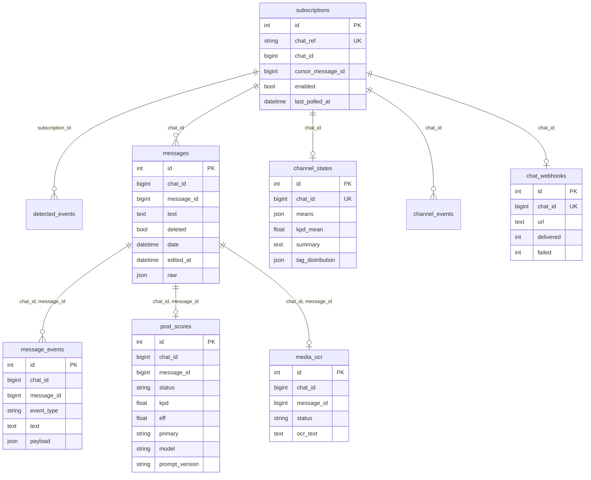

# Data model

Nine tables, defined as SQLModel classes in `doomscroller/models.py`. Schema creation is
`SQLModel.metadata.create_all()` (see [architecture.md](architecture.md#database-layer));
there are no migration scripts.

The tables fall into four groups:

| Group | Tables | Written by |
|---|---|---|
| Archive | `subscriptions`, `messages`, `message_events` | poller / watcher |
| Optional detection | `detected_events` | legacy `detector` extra |
| Scoring | `post_scores`, `channel_states`, `channel_events`, `media_ocr` | scorer, OCR |
| Delivery | `chat_webhooks` | MCP `webhook_*` tools |

## Diagram

## archive

### `subscriptions`

One row per chat/channel. `chat_ref` is the normalised reference the user typed
(`@chan`, `chan`, `t.me/chan` and `https://t.me/chan` all collapse to `chan`);
`chat_id` is Telegram's numeric id, filled in after the first successful poll and
`NULL` until then.

| Column | Type | Notes |
|---|---|---|
| `id` | int PK | |
| `chat_ref` | varchar(255), unique, indexed | normalised, see `subscriptions.normalise_ref` |
| `chat_id` | bigint, indexed, nullable | resolved by `poll`; required to read messages |
| `title` | text, nullable | display name from Telegram |
| `kind` | varchar(32), nullable | `channel` / `chat` / other, from `describe_entity` |
| `enabled` | bool, not null, default `true` | disabled chats are not polled or scored |
| `cursor_message_id` | bigint, not null, default `0` | high-water mark of stored messages |
| `last_polled_at` | timestamptz, nullable | set in the same commit as the cursor |
| `last_error` | text, nullable | last ingest failure, cleared on success |
| `created_at` | timestamptz, not null | |
| `message_count` | bigint, not null, default `0` | incremented by newly created rows only |

**Cursor invariant.** `cursor_message_id` only advances *inside* the transaction that
stored the messages it covers (`ingest.poll_subscription` calls `session.commit()` right
after setting it). A crash before the commit leaves the cursor untouched, so the batch is
re-read. Reads never advance the cursor: `fetch`, `new`, `search` and every MCP tool are
read-only.

### `messages`

Current state of a message, one row per `(chat_id, message_id)`:

* `UniqueConstraint("chat_id", "message_id")` — the upsert target.
* `Index("ix_messages_chat_id_id", "chat_id", "message_id")` — paging by message id.
* `Index("ix_messages_date", "date")` — sorting across chats.

| Column | Notes |
|---|---|
| `chat_id`, `message_id` | bigint, not null |
| `sender_id`, `sender_name` | nullable; name is resolved from Telethon when possible |
| `date` | Telegram's timestamp, timestamptz |
| `text` | caption/text as delivered; **survives deletion** |
| `reply_to_message_id` | nullable |
| `deleted` | bool, not null, default `false` |
| `edited_at` | wall-clock time the edit was archived (not Telegram's `edit_date`) |
| `raw` | JSON snapshot of the Telethon message (`ingest.serialize_message`) |
| `first_seen_at`, `updated_at` | bookkeeping |

`messages` answers "what does this chat look like now". History — including the text of a
message before an edit — lives in `message_events`.

### `message_events`

Append-only log; rows are never updated or deleted.

| Column | Notes |
|---|---|
| `event_type` | `new` / `edited` / `deleted` (`store.VALID_EVENT_TYPES`) |
| `text` | text at the moment of the event (a `deleted` event carries no text) |
| `payload` | raw event payload when available |
| `created_at` | when the event was archived |

Indexes: `(chat_id, message_id)` for replaying one message, `created_at` for time scans.

`record_event` is idempotent for `new`: if the `(chat_id, message_id)` row already exists,
it returns without appending an event or creating a row.

## optional detection

### `detected_events`

Legacy LLM event detector (`ollama` extra in `pyproject.toml`). Not used by the scoring
pipeline. Columns: `chat_id`, `subscription_id` (FK), `event`, `message`, `state_before`,
`state_after`, `created_at`.

## scoring

### `post_scores`

One row per scored message; the unique key is `(chat_id, message_id)`.

`status` is the heart of "unread is a query":

| Status | Meaning | Retried? |
|---|---|---|
| `scored` | rubric applied; axes and KPD are set | only if edited/OCR-updated, or `--force` |
| `skipped` | deliberately not rubric material (text shorter than `SCORER_MIN_CHARS`, or no captioned/OCR text) | only if edited, or `--force` |
| `failed` | backend or parse error; `detail` holds the reason | while `attempts < SCORER_MAX_ATTEMPTS` |

Columns:

| Group | Columns |
|---|---|
| identity | `chat_id`, `message_id`, `message_date`, `title` |
| provenance | `model`, `prompt_version` (12-hex rubric hash), `attempts`, `detail` |
| classification | `genre`, `primary`, `secondary` (JSON array), `main_thesis`, `clauses` (JSON), `density_type`, `flags` (JSON array) |
| axes | `score_i`, `score_v`, `score_u`, `score_p`, `score_s`, `score_d` (floats 0–10) |
| aggregates | `kpd`, `eff` |
| channel view | `deviation` (JSON), `trend_position` (`above`/`at`/`below`), `shift_candidate`, `confidence` |
| explanation | `justification` (JSON), `nearest_anchors` (JSON), `selfcheck` (JSON), `raw` (the model's full answer) |
| timestamps | `scored_at`, `updated_at` |

Indexes: `(chat_id, kpd)` for leaderboards, `scored_at` for freshness, `status` for counts.

`eff` is `NULL` for weak texts (KPD ≤ 5, per the rubric) so it is not averaged into
`channel_states.eff_mean` as a zero.

### `channel_states`

Derived projection of `post_scores` — one row per channel (`chat_id` unique). It is *not*
the source of truth; it can be rebuilt from the score rows with
`state.recompute_state()`.

| Group | Columns |
|---|---|
| identity | `chat_id`, `chat_ref`, `title` |
| memory | `profile_description`, `summary`, `drift_note`, `summary_at`, `summary_post_count` |
| trend | `window`, `means` (JSON, six axes), `deltas` (JSON), `kpd_mean`, `eff_mean`, `eff_n` |
| counters | `total_scored`, `total_skipped`, `total_failed`, `last_scored_message_id`, `last_scored_at` |
| distribution | `tag_distribution` (JSON), `local_anchors` (JSON list of the last anchors) |
| anomaly | `deviation_streak`, `shift_candidate_message_id`, `kpd_max`, `kpd_max_message_id` |
| timestamps | `created_at`, `updated_at` |

`means` is an EWMA over up to `window` scored posts. When a post is re-scored, `store_score`
does not apply an increment — it replays the whole trajectory (`recompute_state`) so the
old value is not double-counted.

### `channel_events`

Append-only trajectory log. `kind` is `shift`, `peak` or `summary`; `note` carries a
human-readable description, `payload` the structured data. Index `(chat_id, created_at)`.

### `media_ocr`

OCR result per image message, unique on `(chat_id, message_id)`, index
`(chat_id, status)`.

| Column | Notes |
|---|---|
| `status` | `ok`, `no_text` (looked at, nothing readable), `error`, `skipped` |
| `ocr_text` | extracted text; `NULL` unless status is `ok` |
| `language` | `eng`, `rus` or `none` (which vision pass won) |
| `engine`, `model` | `llm-vision` + the vision model id |
| `attempts` | language passes used |
| `detail` | error text |
| `prompt_tokens`, `completion_tokens` | cost accounting |

A `no_text` row is a permanent "ignore" verdict: the OCR pass will not re-read that
image unless `--force` is given. `combined_body(caption, ocr_text)` in `ocr.py` is what the
scorer sees as the post text, with an explicit marker separating the author's caption from
photographed text (rubric rule 11 treats borrowed content differently).

## delivery

### `chat_webhooks`

One row per chat (`chat_id` unique) — subscribing the same chat again replaces the URL.

| Column | Notes |
|---|---|
| `chat_id`, `chat_ref` | target; `chat_id` must be resolved |
| `url` | absolute http(s) URL, validated by `mcp_server._check_url` |
| `enabled` | bool, default `true` |
| `delivered`, `failed` | delivery counters |
| `last_error` | last delivery error, cleared on success |
| `last_delivered_at` | last successful POST |
| `created_at`, `updated_at` | |

Delivery body is the raw Telethon update (`webhooks.update_payload`), sent with
`X-Webhook-Token: $WEBHOOK_TOKEN` when the token is configured. A dead endpoint stays
subscribed and shows up in `webhook_list`; it does not stop the listener.

## Cross-cutting notes

* **Timestamps** are `DateTime(timezone=True)`. On PostgreSQL they are `timestamptz`;
  SQLite hands back naive datetimes, which is why `scoring/agent.py::_timestamp` normalises
  to UTC epochs before comparing.
* **Big integers** are used for Telegram ids (`BigInteger`), which exceed 32-bit range for
  channels.
* **JSON columns** are dialect `JSON`, not `JSONB`: the code never queries inside them,
  only reads/writes whole documents.
* **Deletion policy**: nothing in `message_events`, `channel_events` or `post_scores` is
  ever deleted, so the archive and its trajectory are auditable. `unsubscribe` removes only
  the `subscriptions` row; archived messages remain.
